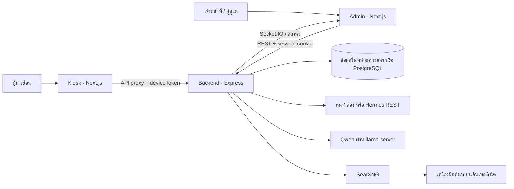

# ภาพรวมระบบ Hermes Reception Control และสถานะงานทั้งหมด

อัปเดต: 6 ตุลาคม 2569  
ขอบเขต: โค้ดในโปรเจ็กต์นี้ ณ วันที่อัปเดต รวมผลทดสอบบนเครื่องพัฒนา ข้อกำหนดหลักอยู่ใน [SPEC.md](../SPEC.md) และบันทึกความคืบหน้าอยู่ใน [PROGRESS.md](../PROGRESS.md)

## วิธีอ่านสถานะ

| สถานะ | ความหมาย |
|---|---|
| **ทำแล้ว** | มีโค้ดใช้งานและมีหลักฐานทดสอบในเครื่องพัฒนา |
| **บางส่วน** | ใช้ได้บางเส้นทาง แต่ยังขาดความสามารถหรือการตรวจยืนยันตามข้อกำหนด |
| **รอตรวจรับ** | มีโค้ดรองรับ แต่ยังไม่ทดสอบกับหุ่น อาคาร หรืออุปกรณ์ปลายทางจริง |
| **ยังไม่ทำ** | ยังไม่มีเส้นทางใช้งานจริง หรือมีเพียงหน้าจอ/สัญญา API ที่คืนว่าไม่พร้อม |

**ภาพรวม:** ระยะที่ 1 มีระบบเว็บ ควบคุมงาน แผนที่ ฐานข้อมูล และตัวเชื่อม Hermes แล้ว แต่ยังไม่เสร็จสำหรับหน้างาน เพราะยังไม่มีการตรวจรับกับหุ่นและแผนที่อาคารจริง ระยะ AI สนทนาด้วยข้อความและค้นเว็บได้ในโหมดหุ่นจำลองบนเครื่องพัฒนา เสียงและการรันบน Jetson ยังไม่เสร็จ

## 1. ระบบนี้ประกอบด้วยอะไร

| ส่วน | หน้าที่ | ตำแหน่งโค้ด |
|---|---|---|
| Admin | แดชบอร์ด ควบคุมหุ่น จัดการแผนที่ งาน ผู้ใช้ และดูบันทึก AI | [`apps/admin`](../apps/admin) |
| Kiosk | จอผู้มาเยือน เลือกจุดหมาย ดูการนำทาง หยุดงาน และพิมพ์คุยกับ AI | [`apps/kiosk`](../apps/kiosk) |
| Backend | ตรวจสิทธิ์ รักษาสถานะหุ่นและงาน ควบคุมคำสั่ง จัดการข้อมูล และประสาน AI | [`apps/backend`](../apps/backend) |
| Shared | ชนิดข้อมูลและกฎตรวจคำขอร่วมกันด้วย Zod | [`packages/shared`](../packages/shared) |
| PostgreSQL | เก็บผู้ใช้ เซสชัน แผนที่ งาน สถานะ และบันทึกเมื่อใช้ `DB_MODE=pg` | [`schema.prisma`](../apps/backend/prisma/schema.prisma) |
| หุ่น | เลือกได้ระหว่างตัวจำลองกับตัวเชื่อม SLAMTEC Hermes REST | [`sim`](../apps/backend/src/sim) และ [`hermes`](../apps/backend/src/hermes) |
| AI | Qwen ผ่าน API ที่เข้ากันกับ OpenAI สำหรับแชตและจำแนกคำสั่ง | [`chatService.ts`](../apps/backend/src/services/chatService.ts) และ [`aiService.ts`](../apps/backend/src/services/aiService.ts) |
| ค้นเว็บ | SearXNG ใน Docker ส่งผล JSON ให้ Backend | [`docker-compose.yml`](../docker-compose.yml) และ [`settings.yml`](../searxng/settings.yml) |

Admin กับ Kiosk เป็น **คนละเว็บ** แต่ใช้ Backend เดียวกัน เบราว์เซอร์ไม่ส่งคำสั่งไปยังหุ่นโดยตรง Kiosk proxy เก็บ device token ไว้ฝั่งเซิร์ฟเวอร์ ส่วน Admin ใช้เซสชันของผู้ใช้

## 2. โหมดการทำงานและข้อมูลที่เก็บ

| โหมด | สถานะและข้อควรเข้าใจ |
|---|---|
| `DB_MODE=memory`, `ROBOT_MODE=sim` | **ทำแล้ว:** มีผู้ใช้ทดลอง 3 บัญชี แผนที่และ POI สมมติ หุ่นจำลอง; ข้อมูลหายเมื่อปิด Backend |
| `DB_MODE=pg`, `ROBOT_MODE=sim` | **ทำแล้วในเครื่องพัฒนา:** ใช้ PostgreSQL 16 กับ Prisma migration บันทึกข้อมูลและคืนข้อมูลหลังเริ่มใหม่; ต้องตั้งรหัสผู้ดูแลเริ่มต้นเอง ไม่มีแผนที่ตัวอย่างที่เผยแพร่ |
| `DB_MODE=pg`, `ROBOT_MODE=hermes` | **รอตรวจรับ:** มีตัวเชื่อม REST และเงื่อนไขบังคับใช้ฐานข้อมูลจริง แต่ยังไม่ยืนยันคำสั่งและค่าที่อ่านได้กับเครื่อง Hermes ของโครงการ |
| `AI_MODE=off` | ค่าเริ่มต้น; ทาง AI ที่ต้องใช้โมเดลไม่พร้อมใช้งาน |
| `AI_MODE=local`, `ROBOT_MODE=sim` | **ทำแล้วสำหรับทดลอง:** แชตข้อความและคำสั่ง AI ใช้โมเดลในเครื่อง ค้นเว็บได้เมื่อ SearXNG เปิดและเครื่องต่ออินเทอร์เน็ต |
| AI กับ `ROBOT_MODE=hermes` | **ยังไม่ทำ/ไม่เปิด:** เส้นทางแชตและคำสั่ง Kiosk ที่ใช้ AI ปฏิเสธโหมดหุ่นจริงโดยตั้งใจจนกว่าจะตรวจรับ |

PostgreSQL มีตาราง `users`, `sessions`, `robots`, `maps`, `pois`, `keepout_zones`, `jobs`, `job_events`, `telemetry_samples`, `control_lock`, `audit_log`, `ai_conversations` และ `ai_rejections` โหมดฐานข้อมูลรุ่นนี้ออกแบบให้มี Backend **หนึ่ง instance** เท่านั้น ข้อมูลแชตทั่วไปจาก `/api/kiosk/chat` ยังไม่ได้บันทึกใน `ai_conversations`; ตารางนั้นเก็บคำขอที่ผ่านทางจำแนกคำสั่ง AI

## 3. ข้อมูลไหลอย่างไร

### ผู้ดูแลและเจ้าหน้าที่

1. ผู้ใช้เข้าสู่ระบบที่ Admin → Backend ตรวจรหัสผ่านแบบ Argon2id → ส่งเซสชันผ่านคุกกี้ `httpOnly` และ `SameSite=Strict`.
2. Admin อ่านสถานะหุ่นผ่าน Socket.IO; หากต่อไม่ได้จะลอง `GET /api/robot/state` ทุก 2 วินาที Backend อ่านหุ่นจริงหรือขยับตัวจำลองทุก 500 มิลลิวินาที และส่งสถานะประมาณทุก 1 วินาที.
3. การควบคุมด้วยมือขอ `control lock` ก่อน ส่งคำสั่งจอยสติ๊กผ่าน WebSocket หรือ REST สำรอง Backend ตรวจบทบาท ผู้ถือ lock และสถานะการเชื่อมต่อก่อนสั่งหุ่น.
4. การนำทางตรวจแผนที่ที่เผยแพร่และ POI แล้วสร้าง `job` พร้อมเหตุการณ์และบันทึกการสั่งงาน งานอัตโนมัติถือ lock เพื่อกันการควบคุมด้วยมือพร้อมกัน.
5. ปุ่มหยุดฉุกเฉินใช้ REST โดยตรง ยกเลิกงานและปลด lock; ในโหมด Hermes ต้องได้รับการยืนยันจากหุ่น หากยืนยันไม่ได้ Backend แจ้งข้อผิดพลาด.

### ผู้มาเยือนที่ Kiosk

1. Kiosk โหลดเฉพาะ POI ที่ `isPublic=true` จากแผนที่ที่เผยแพร่ ผู้มาเยือนแตะจุดหมายได้โดยไม่ต้องใช้เสียงหรือ AI.
2. Kiosk proxy ส่งคำขอพร้อม device token ไป Backend → สร้างงานที่มาจาก `kiosk_touch` → แสดงระยะ/สถานะจาก `/api/kiosk/session/:jobId` ทุก 2 วินาที ผู้มาเยือนกดหยุดงานของ Kiosk ได้.
3. หากเลือกแชต ข้อความและประวัติช่วงสั้นส่งไป `/api/kiosk/chat` Backend เลือกทาง `chat`, `database`, `web` หรือ `action` จากกฎและโมเดล แล้วทยอยส่งคำตอบกลับเป็น NDJSON.
4. ทาง `database` ใช้ POI สาธารณะของแผนที่ที่เผยแพร่; ทาง `web` ค้นผ่าน SearXNG แล้วส่งข้อความย่อและลิงก์สูงสุด 4 รายการให้โมเดล; ทาง `action` ผ่านตัวตรวจคำสั่งและบริการงานนำทางเดิมก่อนขยับหุ่นจำลอง.
5. Kiosk แสดงลิงก์แหล่งข้อมูลและเวลาที่ **ดึงผลค้นหา** เวลานี้ไม่ใช่วันเผยแพร่หรือวันหมดอายุของข้อมูลในหน้าเว็บ.

**การเรียกเครื่องมือของ AI:** ตอนนี้ Backend เป็นผู้เลือกและเรียกเครื่องมือที่กำหนดไว้ในโค้ด โมเดลไม่มี URL หุ่นหรือสิทธิ์สั่งหุ่นโดยตรง ยังไม่มีระบบให้โมเดลเรียกหลายเครื่องมืออย่างอิสระในคำขอเดียว และยังไม่มีลำดับงานหลายขั้นตอนแบบทั่วไป

## 4. สถานะงานระยะที่ 1: Admin และหุ่น

| ข้อกำหนด | สถานะ | สิ่งที่มี / สิ่งที่ยังขาด |
|---|---|---|
| CON-01 บัญชีและการเข้าสู่ระบบ | **ทำแล้ว** | สมัครเป็น `viewer`, เข้าสู่ระบบ/ออกจากระบบ, จำกัดความถี่ล็อกอิน, จัดการเซสชัน; โหมดจำลองมีบัญชีทดลอง |
| CON-02 แดชบอร์ดและสถานะสด | **บางส่วน** | แสดงแบตเตอรี่ พิกัด ความเร็ว งาน lock และสถานะลิงก์; ยังไม่ผูกค่า Wi-Fi, CPU, LiDAR จริง และยังไม่วัดความหน่วงกับ Hermes |
| CON-03 จอยสติ๊กและหยุดการขับ | **รอตรวจรับ** | จอยสติ๊ก 8 ทิศ, lock, heartbeat, dead-man ในตัวจำลอง, REST สำรอง และคำสั่ง Hermes; ยังไม่วัดหรือทดสอบการเคลื่อนจริง |
| CON-04 สั่งไปจุดหมาย | **รอตรวจรับ** | เลือก POI และสร้างงานพร้อมความคืบหน้า/ETA โดยประมาณ; ยังไม่ยืนยันพิกัด เส้นทาง และเวลาเดินทางจริง |
| CON-05 กลับแท่นชาร์จ | **รอตรวจรับ** | สั่งกลับแท่นและสร้างงานอัตโนมัติเมื่อแบตต่ำกว่า 15%; ยังไม่ทดสอบการเข้าจอดจริง |
| CON-06 แผนที่และ POI | **บางส่วน** | นำเข้า JSON, แก้ POI และเขตห้ามผ่าน, ตรวจขอบแผนที่/จุดแท่นชาร์จ; ยังไม่มีแผนที่ SLAM ของอาคารจริง การนำเข้า `.stcm` หรือการส่งเขตห้ามผ่านไปหุ่น |
| CON-07 จัดการผู้ใช้ | **ทำแล้ว** | Admin เพิ่ม แก้ ปิดบัญชี และกำหนดบทบาทได้; ทดสอบ API ในโหมดจำลอง |
| CON-08 หยุดฉุกเฉิน | **รอตรวจรับ** | ปุ่มและ REST endpoint มีแล้ว ทดสอบตรรกะกับตัวจำลอง/คำตอบ REST จำลอง; ยังต้องพิสูจน์ว่าหุ่นจริงหยุดและปลดสถานะได้ถูกต้อง |
| CON-09 เวอร์ชันแผนที่ | **ทำแล้วในซอฟต์แวร์** | ร่าง เผยแพร่ เก็บเวอร์ชัน และย้อนเวอร์ชัน; ยังต้องตรวจความตรงกับแผนที่ที่โหลดบนหุ่น |
| CON-10 ประวัติงานและบันทึก | **ทำแล้วในซอฟต์แวร์** | รายการงาน เหตุการณ์ และ audit log มีในโหมดฐานข้อมูล; ยังต้องตรวจผลลัพธ์กับหุ่นจริง |
| CON-11 สิทธิ์สามระดับ | **ทำแล้ว** | `viewer` ดู, `operator` สั่งงาน, `admin` จัดการผู้ใช้/แผนที่; Backend ตรวจสิทธิ์ฝั่งเซิร์ฟเวอร์ |

ตัวจำลองเคลื่อนเข้าหาเป้าหมายแบบพื้นฐานและ **ไม่ได้วางเส้นทางหลบ `keepout_zones`** การเห็นรูปเขตห้ามผ่านบนแผนที่จึงไม่ใช่หลักฐานว่าหุ่นจะหลบได้ การนำทางบนหุ่นจริงต้องพึ่งระบบ SLAM และการตรวจหน้างาน

## 5. สถานะ Kiosk และเสียง

| ข้อกำหนด | สถานะ | รายละเอียด |
|---|---|---|
| RBT-01 แตะเลือกจุดหมายสาธารณะ | **ทำแล้วในโหมดจำลอง** | ดึงเฉพาะ POI สาธารณะจากแผนที่ที่เผยแพร่ |
| RBT-02 แปลงเสียงเป็นข้อความ | **ยังไม่ทำ** | ไม่มี STT; `/api/kiosk/voice` คืน 501 |
| RBT-03 พูดตอบ | **ยังไม่ทำ** | ไม่มี TTS หรือการเล่นเสียงตอบ |
| RBT-04 แสดงการพาไป | **ทำแล้วในโหมดจำลอง** | แสดงสถานะ ระยะคงเหลือ และแผนที่จากงาน; ยังรอตรวจบนจอหุ่นจริง |
| RBT-05 ไทย/อังกฤษ | **ทำแล้วในซอฟต์แวร์** | สลับภาษาหน้า Kiosk ค่าเริ่มต้นไทย; ยังต้องตรวจคำตอบ AI และการจัดวางกับผู้ใช้จริง |
| RBT-06 ปุ่มหยุดบนจอ | **ทำแล้วในโหมดจำลอง** | ยกเลิกเฉพาะงานที่เริ่มจาก Kiosk; ยังต้องตรวจการหยุดหุ่นจริง |

หน้าสนทนาพิมพ์ถามต่อ เริ่มบทสนทนาใหม่ ยกเลิกคำตอบที่กำลังมา และแสดงแหล่งค้นเว็บได้ ข้อความสนทนาอยู่ในสถานะของหน้าเว็บช่วงที่เปิดใช้งาน ยังไม่ใช่ประวัติถาวร

## 6. สถานะ AI และอินเทอร์เน็ต

| ข้อกำหนด | สถานะ | รายละเอียด |
|---|---|---|
| AI-01 จำกัดคำสั่งที่มีผลต่อหุ่น | **ทำแล้วในโหมดจำลอง** | คำสั่งจำแนกอยู่ในชุดปิด และรับเฉพาะ POI ที่ตรวจได้ |
| AI-02 ชั้นตรวจคำสั่ง | **ทำแล้วในโหมดจำลอง** | ตรวจรูปแบบผลโมเดล คะแนนขั้นต่ำ POI สาธารณะ งานที่กำลังทำ และบันทึกการปฏิเสธ; คะแนนความมั่นใจยังไม่ผ่านการปรับเทียบ |
| AI-03 การเรียกเครื่องมือ | **บางส่วน** | Backend เรียกข้อมูลอาคาร ค้นเว็บ และบริการงานนำทางตามทางที่เลือกได้; ยังไม่มีเครื่องมือครบทุกชนิดหรือคำขอหลายขั้นตอน |
| AI-04 สนทนาทั่วไป | **บางส่วน** | ตอบไทย/อังกฤษและใช้ข้อความก่อนหน้าสูงสุด 7 รายการ; ยังไม่ได้ประเมินความถูกต้องอย่างเป็นระบบหรือเก็บแชตถาวร |
| AI-05 เลือกวิธีตอบ | **บางส่วน** | แยก `chat/database/web/action`; ยังไม่ถามกลับอย่างเป็นระบบเมื่อกำกวม และทำหลายขั้นตอนในคำขอเดียวไม่ได้ |
| AI-06 ค้นอินเทอร์เน็ต | **บางส่วน** | SearXNG คืนผล JSON มีลิงก์และเวลาที่ดึงผล; ยังไม่เปิดอ่านหน้าเว็บต้นทางเพื่อตรวจวันเผยแพร่ วันหมดอายุ หรือข้อเท็จจริงทั้งหน้า |
| AI-07 คำตอบอิงข้อมูล | **บางส่วน** | เรื่องอาคารใช้ POI สาธารณะและเว็บใช้ข้อความย่อพร้อมลิงก์; ยังไม่มีฐานความรู้อาคารครบหรือระบบยืนยันว่าทุกข้อความในคำตอบตรงแหล่งข้อมูล |
| AI-08 ตอบแบบทยอยแสดง | **ทำแล้วในโหมดจำลอง** | ส่งคำตอบเป็นช่วง ยกเลิกคำขอ และเริ่มบทสนทนาใหม่บน Kiosk ได้ |

คำสั่ง `navigate_to`, `where_is` และ `cancel_job` ทำงานกับหุ่นจำลองแล้ว ส่วน `answer_question` จากฐานข้อเท็จจริงอาคาร, `check_in_visitor` และ `call_reception` ยังไม่มีบริการปลายทางและถูกปฏิเสธพร้อมบันทึกเหตุผล หน้า AI ใน Admin แสดงสถานะและบันทึกจากทางจำแนกคำสั่ง แต่ **ยังไม่แสดงประวัติแชตทั่วไป**

SearXNG รันเองใน Docker และไม่ต้องซื้อคีย์ Search API แต่ยังต้องใช้อินเทอร์เน็ตเพื่อค้นผ่านผู้ให้บริการภายนอก ผลค้นหาอาจถูกจำกัดหรือว่างได้ โมเดลขนาดเล็กยังอาจตีความโปรโมชันและวันที่ผิด แม้มีคำกำกับไม่ให้ยืนยันข้อเสนอที่ไม่มีช่วงเวลาแน่ชัด

## 7. API และเหตุการณ์หลัก

| กลุ่ม | เส้นทาง / เหตุการณ์ | สถานะ |
|---|---|---|
| สุขภาพ | `GET /api/health` | ใช้ได้ |
| บัญชี | `/api/auth/register`, `/login`, `/logout`, `/me` | ใช้ได้ |
| หุ่น | `/api/robot/state`, `/lock`, `/lock/heartbeat`, `/manual`, `/halt`, `/estop`, `/dock` | ใช้ได้ในโหมดจำลอง; Hermes รอตรวจรับ |
| งาน | `/api/jobs`, `/current`, `/:id`, `/:id/cancel` | ใช้ได้ในโหมดจำลองและฐานข้อมูล |
| แผนที่ | `/api/maps/import`, `/draft`, `/draft/pois`, `/draft/keepouts`, `/draft/publish`, `/versions`, `/:version/rollback`, `/published`, `/pois` | ใช้ได้กับข้อมูลแผนที่ JSON |
| ผู้ใช้ | `/api/users` และ `/:id` | ใช้ได้สำหรับ admin |
| AI ผู้ดูแล | `/api/ai/status`, `/intent`, `/rejections`, `/conversations` | ทางจำแนกคำสั่งใช้ได้เมื่อเปิด AI; บันทึกแชตทั่วไปยังไม่มี |
| Kiosk | `/api/kiosk/destinations`, `/escort`, `/session/:jobId`, `/cancel`, `/ai-status`, `/chat`, `/intent` | ใช้ได้ตามโหมดที่เปิด |
| เสียง | `POST /api/kiosk/voice` | ยังไม่ทำ; คืน 501 |
| สถานะสด | Socket.IO: `telemetry`, `robot:link`, `lock:changed`, `job:update`, `map:published`; รับ `joystick` | ใช้ได้ในโหมดจำลอง |

รายละเอียด payload และกฎตรวจอยู่ใน [`packages/shared/src/schemas.ts`](../packages/shared/src/schemas.ts) และเส้นทางจริงอยู่ใน [`apps/backend/src/routes`](../apps/backend/src/routes)

## 8. ความปลอดภัยและข้อจำกัดการใช้งาน

- **ทำแล้ว:** รหัสผ่านเข้ารหัสแบบ Argon2id, คุกกี้เซสชันฝั่ง Admin, บทบาทสามระดับ, device token ของ Kiosk, การตรวจข้อมูลด้วย Zod, lock การควบคุม, งานนำทางหนึ่งงานต่อครั้ง, ปฏิเสธคำสั่งเคลื่อนเมื่อหุ่นขาดการเชื่อมต่อ และบันทึกเหตุการณ์สำคัญ
- **ทำแล้ว:** Kiosk proxy ไม่ส่ง token ไปยัง JavaScript ในเบราว์เซอร์; ข้อความจากเว็บถูกส่งให้โมเดลเป็นข้อมูลที่ไม่เชื่อถือ และไม่สามารถสั่งหุ่นผ่านข้อความเว็บโดยตรง
- **ยังต้องตรวจ:** ความปลอดภัยทางกายภาพกับหุ่นจริง, การตั้งค่า secret สำหรับ production, การเปิดบริการผ่านเครือข่ายจริง, สิทธิ์และข้อมูลส่วนบุคคล, การทดสอบการเข้าถึงของผู้ใช้ และการทดสอบโหลด
- **ข้อจำกัดระบบปัจจุบัน:** โหมด PostgreSQL ใช้ Backend หนึ่ง instance; `slamMapRef` เป็นค่าอ้างอิง ไม่ได้ตรวจว่าแผนที่เดียวกันถูกโหลดบนหุ่น; การตรวจเว็บใช้ข้อความย่อ ไม่ใช่หลักฐานว่าข้อเสนอยังใช้ได้; ข้อความจาก LLM ยังอาจผิดพลาด

### ข้อกำหนดที่ยังไม่มีผลตรวจรับครบ

| กลุ่ม | สถานะ |
|---|---|
| NFR-01 ถึง NFR-03 ความเร็วแดชบอร์ด telemetry และจอยสติ๊ก | **รอวัดบนเครื่อง เครือข่าย และหุ่นจริง** |
| NFR-04 ถึง NFR-06 รหัสผ่าน คุกกี้ และตรวจสิทธิ์ฝั่ง Backend | **มีโค้ดและการทดสอบบางส่วน**; ยังต้องทบทวนก่อนใช้งานจริง |
| NFR-07 ถึง NFR-08 หยุดฉุกเฉินและการแสดงสถานะลิงก์ | **ผ่านตรรกะจำลอง**; รอตรวจสถานการณ์หลุดลิงก์และการหยุดกับ Hermes จริง |
| NFR-09 ถึง NFR-10 การเข้าถึงและขนาดจอ Kiosk | **มีการออกแบบรองรับ**; ยังไม่มีผลตรวจด้วยเครื่องมือและจอเป้าหมายครบ |
| NFR-11 บันทึกคำสั่งหุ่น | **มี audit/event ในซอฟต์แวร์**; ยังต้องตรวจว่าบันทึกผลคำสั่งและผลจากหุ่นจริงครบ |

## 9. การเปิดระบบและผลตรวจล่าสุด

| ชุดทดสอบ | พอร์ต | วิธีเปิด / เงื่อนไข |
|---|---|---|
| โหมดจำลองพื้นฐาน | Admin `3000`, Kiosk `3001`, Backend `4000` | `pnpm dev` หลังตั้ง `.env` และ Kiosk token; ไม่ต้องใช้ Docker |
| AI บนเครื่องพัฒนา | Admin `3003`, Kiosk `3002`, Backend `4100`, Qwen `8080`, SearXNG `8888` | เปิดแต่ละบริการตาม [คู่มือ Phase AI](phase2-local-ai.md); ใช้ `DB_MODE=memory`, `ROBOT_MODE=sim`, `AI_MODE=local` |
| ฐานข้อมูลจริง | PostgreSQL `5432` | `docker compose up -d`, สร้าง Prisma client และรัน migration ตาม [คู่มือระยะที่ 1](phase1-setup.md) |

บัญชี `admin/admin123`, `operator/operator123`, `viewer/viewer123` ใช้ **เฉพาะโหมดจำลองในเครื่องพัฒนา** โหมด PostgreSQL สร้างบัญชี `admin` จาก `INITIAL_ADMIN_PASSWORD` ที่ตั้งเองครั้งแรก

ผลตรวจวันที่ 6 ตุลาคม 2569: `pnpm typecheck` ผ่านทั้ง Admin, Backend และ Kiosk; `pnpm --filter @hermes/backend test` ผ่าน **31/31 รายการ**; `docker compose --profile ai config --quiet` ผ่าน ก่อนหน้านี้ทดสอบคำถามผ่านเว็บ Kiosk จริง ได้คำตอบผ่าน SearXNG พร้อม 4 แหล่งข้อมูลโดยไม่มีเหตุการณ์ผิดพลาด ผลเหล่านี้ยัง **ไม่ใช่การตรวจรับกับหุ่นจริงหรือผลวัดบน Jetson**

## 10. งานที่เหลือ เรียงตามลำดับ

1. **ปิดระยะที่ 1:** เตรียม Hermes Pro Max, เครือข่าย, IP และเฟิร์มแวร์จริง; ตรวจ telemetry, คำสั่งจอยสติ๊ก, E-Stop, งานนำทาง, กลับแท่นชาร์จ และการกู้สถานะหลังขัดข้อง
2. **แผนที่อาคารจริง:** วัดพิกัด POI/แท่นชาร์จ, ผูกกับแผนที่ SLAM ที่หุ่นโหลดจริง, ตรวจเขตห้ามผ่านและการเดินทางก่อนเผยแพร่ให้ Kiosk
3. **ตรวจคุณภาพระยะที่ 1:** วัดความเร็วตาม NFR, ตรวจการเข้าถึงด้วยคีย์บอร์ดและจอเป้าหมาย, ทบทวน secret/เครือข่าย/บันทึกก่อนใช้งานจริง
4. **เพิ่มความน่าเชื่อถือของ AI:** เปิดอ่านหน้าแหล่งข้อมูล ตรวจวันเผยแพร่และวันหมดอายุ แยกข้อความที่ยืนยันได้จากข้อสรุปของโมเดล และทดสอบคำถามไทย/อังกฤษหลายรูปแบบ
5. **ขยายเครื่องมือ AI:** เพิ่มฐานข้อเท็จจริงอาคาร บริการเช็กอินและเรียกเจ้าหน้าที่ การถามกลับเมื่อกำกวม และคำขอหลายขั้นตอน พร้อมบันทึกประวัติแชตที่เหมาะกับนโยบายข้อมูล
6. **เสียงและอุปกรณ์ปลายทาง:** เพิ่ม STT/TTS, วัด LLM+STT+TTS บน Jetson Xavier NX 8GB, เลือกโมเดลจากผลวัดจริง แล้วตรวจรับ AI กับหุ่นและผู้ใช้งานจริง

เอกสารวิธีลงมือ: [เริ่มโปรเจ็กต์](../README.md) · [ติดตั้งและตรวจรับระยะที่ 1](phase1-setup.md) · [ทดลอง AI บนเครื่องพัฒนา](phase2-local-ai.md)
